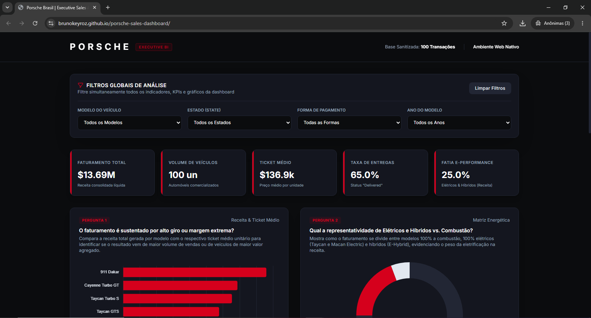
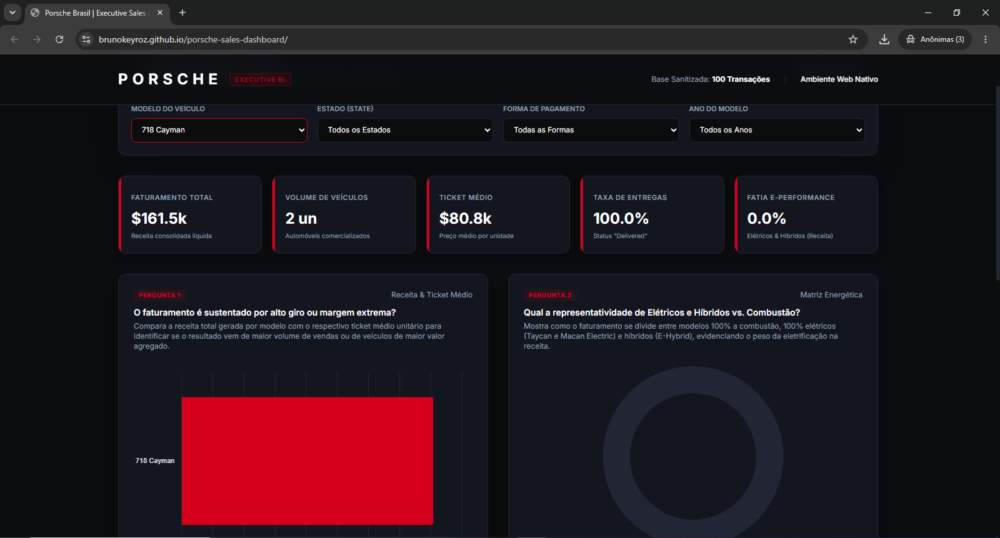

# Porsche Executive Sales & Performance Dashboard

Dashboard executivo interativo desenvolvido em HTML, CSS e JavaScript para análise de desempenho comercial da Porsche. O projeto apresenta indicadores estratégicos, gráficos analíticos e uma tabela detalhada de vendas, permitindo explorar os dados por meio de filtros globais.

## 1. Visão geral do projeto

A dashboard foi concebida para oferecer uma visão consolidada do desempenho comercial, facilitando a interpretação dos resultados e a identificação de padrões relacionados a faturamento, volume de vendas, portfólio de veículos e operações de entrega.

A interface foi desenvolvida em arquivo único (`index.html`), com visualização responsiva e interação dinâmica.

## 2. Funcionalidades

### Filtros globais

A dashboard disponibiliza quatro filtros que atualizam simultaneamente os indicadores, gráficos e registros da tabela:

- **Modelo do Veículo:** permite selecionar modelos específicos da Porsche.
- **Estado:** filtra as vendas conforme a localização geográfica.
- **Forma de Pagamento:** permite analisar os resultados por modalidade de pagamento.
- **Ano do Modelo:** possibilita segmentar os veículos pelo ano do modelo.

### Indicadores de desempenho (KPIs)

São apresentados cinco indicadores principais:

| Indicador | Descrição |
|---|---|
| Faturamento Total | Soma dos valores das vendas consideradas nos filtros ativos. |
| Volume de Veículos | Quantidade de registros de vendas. |
| Ticket Médio | Valor médio por veículo vendido. |
| Taxa de Entregas | Percentual de registros com status Delivered. |
| Fatia E-Performance | Participação da receita de veículos elétricos e híbridos no faturamento total. |

### Análises estratégicas

A dashboard apresenta três análises principais:

**1. O faturamento é sustentado por alto giro ou margem extrema?**

Gráfico de barras horizontais que compara a receita gerada por modelo de veículo. O tooltip também apresenta o ticket médio de cada modelo.

A visualização permite comparar a contribuição de cada modelo para o faturamento. Entretanto, como não existem dados de custos, não é possível calcular ou comprovar margens de lucro.

**2. Qual a representatividade de Elétricos e Híbridos vs. Combustão?**

Gráfico de rosca que apresenta a distribuição da receita entre três categorias:

- 100% Combustão.
- 100% Elétrico (BEV).
- Híbrido (PHEV).

A análise permite observar a participação dos veículos eletrificados no faturamento.

**3. Quais meios de pagamento concentram atrasos na entrega ou pendências?**

Gráfico de barras agrupadas que relaciona as formas de pagamento aos diferentes status operacionais das vendas.

A visualização permite identificar a distribuição dos registros por modalidade de pagamento e situação da entrega. A associação observada não significa, necessariamente, que a forma de pagamento seja a causa de atrasos ou pendências.

### Tabela detalhada de vendas

A dashboard também apresenta uma tabela com os registros individuais, contendo:

- ID da venda.
- Data da venda.
- Cliente.
- Modelo do veículo.
- Ano do modelo.
- Cidade e estado.
- Forma de pagamento.
- Status operacional.
- Preço de venda (USD).

A tabela acompanha os filtros globais, permitindo consultar os registros correspondentes aos critérios selecionados.

## 3. Estrutura e tratamento dos dados

A dashboard utiliza uma base de 100 registros de vendas, identificados pelos IDs de 6 a 105.

Os dados são incorporados diretamente ao código JavaScript do arquivo HTML, por meio da estrutura `porscheSalesData`.

Os valores financeiros são apresentados em dólares americanos (USD).

### Classificação de motorização

A classificação de motorização utilizada na análise E-Performance é representada pelo campo `powertrain`, incorporado diretamente aos registros no código da dashboard.

As categorias utilizadas são:

- `100% Combustão`
- `100% Elétrico (BEV)`
- `Híbrido (PHEV)`

Essa classificação é um campo adicional da estrutura de dados da dashboard e não deve ser considerada uma coluna original da planilha de origem.

### Status operacionais

Os registros são classificados conforme os status operacionais presentes na base, incluindo:

- Delivered
- Shipped
- In Transit
- Awaiting Delivery
- Awaiting Pickup
- Pending
- Pending Approval
- Pending Review
- Awaiting Review
- Cancelled

A taxa de entregas considera exclusivamente os registros classificados como `Delivered`.

## 4. Tecnologias utilizadas

| Tecnologia | Aplicação |
|---|---|
| HTML5 | Estrutura da aplicação. |
| CSS3 | Estilização e apresentação visual. |
| JavaScript | Lógica de filtros, cálculos e interatividade. |
| Tailwind CSS | Apoio à construção da interface. |
| Chart.js | Construção dos gráficos. |
| Google Fonts – Inter | Tipografia da dashboard. |

As bibliotecas externas são carregadas por meio de CDNs. Portanto, é necessária uma conexão com a internet para o carregamento completo da interface e de seus recursos externos.

## 5. Estrutura do projeto

O projeto possui uma estrutura simplificada, com a aplicação concentrada em um único arquivo:

```text
porsche-executive-dashboard/
│
├── index.html
├── README.md
│
└── assets/
    ├── visao-geral-dashboard.png
    └── filtro-porsche-718-cayman.png
```

- `index.html`: contém a estrutura visual, os estilos, os dados e a lógica de funcionamento da dashboard.
- `README.md`: apresenta a documentação do projeto.
- `assets/`: armazena as capturas de tela utilizadas como evidências visuais.

## 6. Como executar localmente

1. Faça o download ou clone do repositório.
2. Abra a pasta do projeto.
3. Localize o arquivo `index.html`.
4. Abra o arquivo em um navegador moderno, como Google Chrome, Microsoft Edge ou Firefox.

Não é necessário instalar dependências localmente, pois as bibliotecas utilizadas são carregadas por CDNs.

É necessária conexão com a internet para carregar corretamente os recursos externos.

## 7. Evidências de funcionamento

As capturas de tela abaixo demonstram a interface da dashboard e o funcionamento dos filtros interativos.

### 7.1. Visão geral da dashboard

A primeira captura apresenta a dashboard em sua visualização inicial, permitindo observar os indicadores de desempenho (KPIs), os gráficos estratégicos e a tabela de transações.




### 7.2. Exemplo de filtro aplicado — Porsche 718 Cayman

Nesta demonstração, o filtro **Modelo do Veículo** foi configurado para `718 Cayman`, enquanto os demais filtros permanecem com a opção padrão.

A aplicação do filtro atualiza os indicadores, os gráficos e a tabela de transações, permitindo analisar os resultados referentes ao modelo selecionado.




**O que esta evidência demonstra:**

- Seleção de um modelo específico.
- Atualização dinâmica dos indicadores.
- Reprocessamento dos gráficos conforme o filtro selecionado.
- Atualização da quantidade e dos registros exibidos na tabela.
- Integração entre os filtros e os componentes da dashboard.

*Observação: substitua as imagens ilustrativas acima por capturas reais da dashboard em execução no navegador. As imagens devem corresponder exatamente aos estados descritos.*

## 8. Considerações e limitações analíticas

Para interpretar corretamente os resultados, é importante considerar algumas limitações:

- **Margem de lucro:** a base apresenta preços de venda, mas não contém custos de aquisição, despesas ou custos operacionais. Portanto, não permite calcular margens ou lucratividade.
- **E-Performance:** a análise depende da classificação `powertrain` incorporada aos dados da dashboard.
- **Entregas:** a taxa de entregas considera registros com status `Delivered`, não necessariamente entregas confirmadas por documentação externa.
- **Formas de pagamento:** a relação entre pagamento e status operacional permite identificar padrões, mas não comprova causalidade.
- **Dados de clientes:** antes da publicação pública, é necessário confirmar que os nomes apresentados são fictícios ou que existe autorização para sua divulgação. Caso contrário, recomenda-se anonimizar esses dados.

## 9. Objetivo do projeto

O projeto demonstra a aplicação de conceitos de análise de dados e Business Intelligence na construção de uma ferramenta de acompanhamento executivo.

A proposta é transformar registros de vendas em informações visuais e interativas, facilitando a leitura dos indicadores comerciais e apoiando a análise do desempenho da operação.

---

**Porsche Executive Sales & Performance Dashboard**

Dashboard desenvolvido para fins de análise e demonstração de Business Intelligence.
